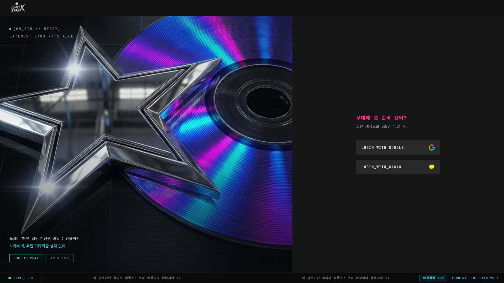
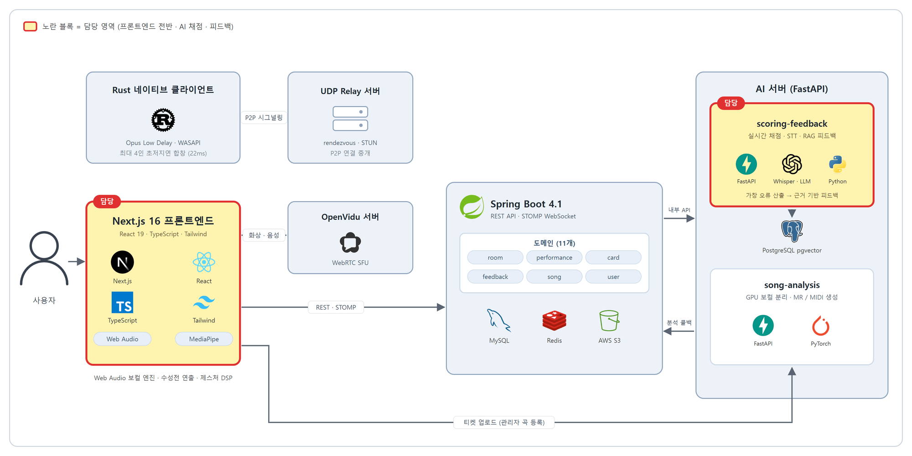
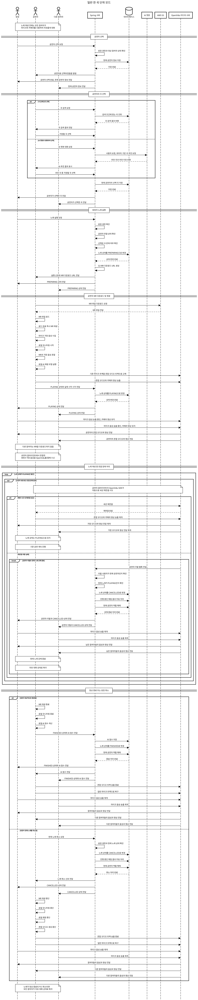
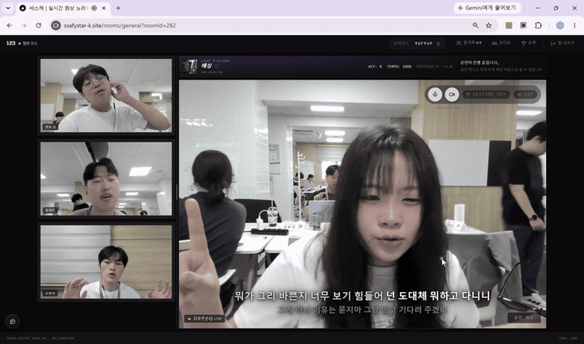
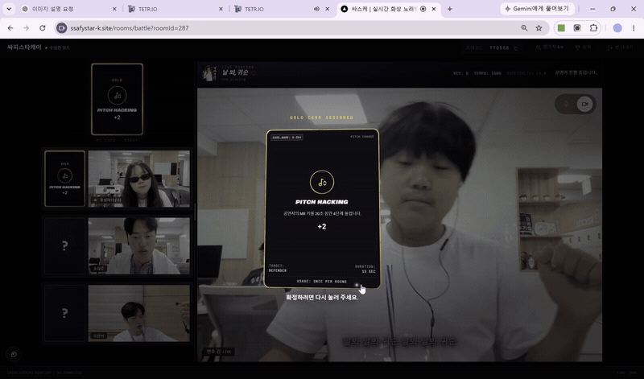
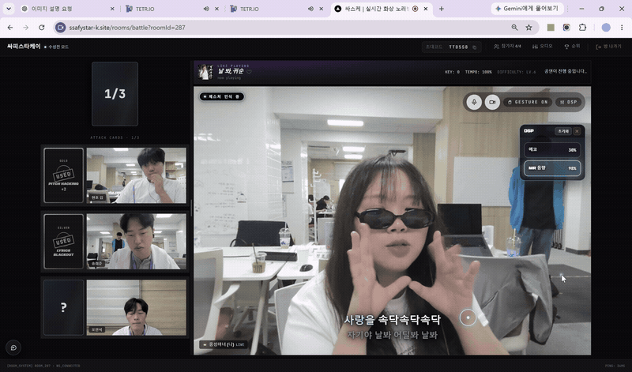
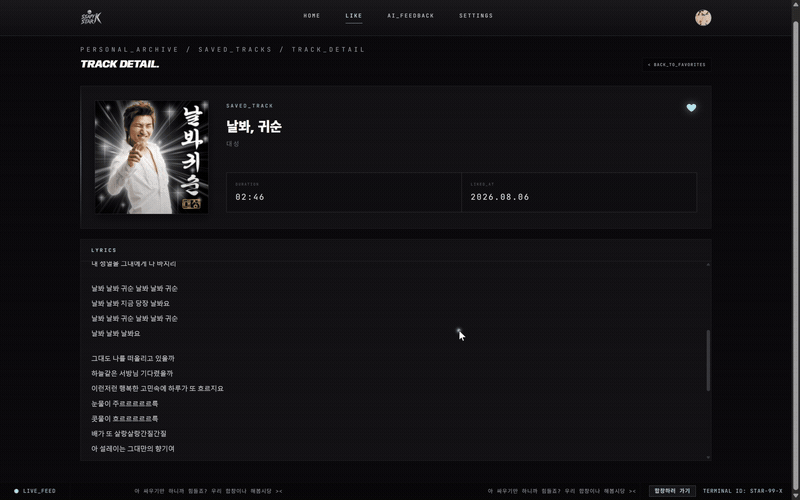
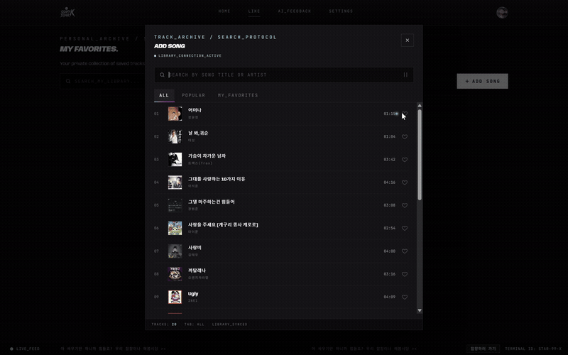
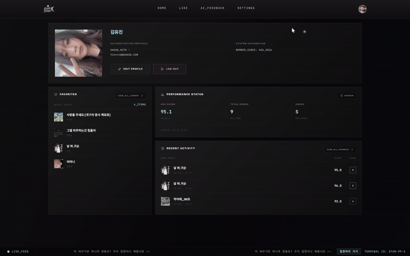

# 장민석 | 싸스케에서 맡은 일
## 싸스케 (SSASUKAE · SSAFY STAR K) — 실시간 화상 노래방

> **친구들과 화상으로 만나 함께 부르고, 카드로 방해하고, AI에게 피드백 받는 실시간 노래방 서비스**



### 프로젝트 개요
- **프로젝트 기간**: 2026.07.15 ~ 2026.08.13 (SSAFY 15기 공통 프로젝트, 6인 팀)
- **담당 역할**: Frontend & AI
- **수상**: SSAFY 15기 공통 프로젝트 **우수상**
- 프로젝트 기간이 끝나 배포 서버는 운영하지 않습니다. 실제 동작은 하단 [동작 시연](#동작-시연) GIF를 보면 됩니다
- **맡은 일**:
  - 브라우저에서 돌아가는 Web Audio 보컬 엔진과 오디오 신호 흐름
  - 화상 노래방 안의 카드 배틀 연출
  - 웹캠 손 제스처로 음정·템포를 바꾸는 기능
  - AI 가창 피드백 기획과 마이페이지 화면

---

## 시스템 구조
> **노란 블록**이 제가 기획하거나 만든 부분입니다.



---

## 방 흐름 (시퀀스 다이어그램)
제가 흐름을 설계하고 구현에 참여한 '일반 노래방 모드'와 '수성전(카드 배틀) 모드'의 순서도입니다.

**[일반 노래방 모드 플로우]**


**[수성전 모드 플로우]**


---

## 사용 기술

### Frontend
- **Framework & Libraries**: Next.js 16, React 19, TypeScript, Tailwind CSS
- **State & Data**: Zustand 5, TanStack Query 5
- **Real-time & Media**: OpenVidu (WebRTC), `@stomp/stompjs` (WebSocket)
- **Vision**: MediaPipe Hands (웹캠 손 제스처 인식)

### Audio & DSP
- Web Audio API, Tone.js
- SoundTouch AudioWorklet (실시간 템포/피치 시프트)
- RNNoise WASM (노이즈 억제), pitchy (피치 검출)

### AI
- FastAPI, OpenAI API (gpt-5-mini, whisper-1)
- PostgreSQL pgvector (RAG 기반 피드백)

---

## 맡은 일 자세히

### 1. Web Audio로 만든 보컬 엔진 (FE)
브라우저에서도 노래방 마이크처럼 들리도록 오디오 파이프라인을 만들었습니다.
- **노이즈 억제와 에코**: RNNoise(WASM)로 잡음을 지우고, Tone.js 리버브로 마이크 소리에 에코를 입혔습니다.
- **AudioWorklet**: 소리 처리를 메인 스레드에서 떼어 내서 화면이 바쁠 때도 소리가 끊기지 않게 했고, 처리한 소리를 WebRTC 화상 스트림에 그대로 실었습니다.

### 2. 실시간 이벤트에 맞춘 카드 배틀 연출 (FE)
WebSocket으로 들어오는 실시간 이벤트에 맞춰 카드 연출과 방 화면이 바뀌도록 만들었습니다.
- **수성전 카드 연출**: 카드가 발동되면 원형 타이머, 히트 컷인, 음파 리플이 뜨는 연출을 애니메이션 라이브러리 없이 CSS keyframes로 만들었습니다.
- **방 상태 맞추기**: 대기방 → 곡 선택 → 공연 시작으로 넘어가는 방 흐름과 채팅, 가사 싱크가 참가자 화면끼리 어긋나지 않게 했습니다.

### 3. 손 제스처로 키·템포 바꾸기 (FE/AI)
키보드나 마우스 없이, 노래를 부르는 도중 손 제스처만으로 키와 템포를 바꿀 수 있게 했습니다.
- **제스처 인식**: MediaPipe Hands로 브라우저에서 바로 손 모양을 읽습니다. 서버를 거치지 않아서 인식부터 소리 반영까지 브라우저 안에서 끝납니다.
- **키·템포 바꾸기**: 읽은 제스처 값으로 SoundTouch AudioWorklet을 움직여, 재생 중인 반주의 키와 템포를 바로 바꿉니다.

### 4. AI 가창 피드백 기획과 마이페이지 (AI/FE)
부른 노래를 분석해 피드백을 주는 AI 기능을 기획하고, 결과를 보는 화면을 만들었습니다.
- **AI 구조 기획**: Whisper(STT)로 받아 적은 가사와 pgvector(RAG)에 쌓은 자료를 엮어 LLM이 피드백을 쓰도록 AI 서버 구조와 프롬프트를 기획했습니다.
- **마이페이지**: 지난 공연 기록, AI 피드백 요약, 능력치 차트를 한 화면에서 보는 반응형 대시보드를 만들었습니다.

---

## 트러블슈팅

### 1. 청자 화면의 가사 하이라이트가 실제 들리는 소리보다 앞서가는 문제
- **문제**: 가창자의 목소리·MR은 WebRTC 지터 버퍼와 인코딩·디코딩을 거쳐 늦게 들리는데, 가사 시계는 공연 시작 이벤트 기준으로 곧바로 돌기 때문에 청자 화면에서는 가사가 소리보다 먼저 넘어감. 고정 상수로 보정해도 지터 버퍼가 네트워크 상태에 따라 계속 변해 참가자·시점마다 다시 어긋남.
- **해결**:
  1. WebRTC `getStats()`의 `jitterBufferDelay` 누적치를 1초 주기로 폴링, 스냅샷 간 차분으로 구간 평균 체류시간을 계산하고 지수이동평균(α=0.3)으로 스무딩해 **지터 버퍼 지연을 실측**.
  2. 가사 시계의 기준 신호(MR 위치 시그널)도 오디오와 같은 네트워크 경로를 타므로 **전송 지연은 서로 상쇄**된다는 점을 이용. 실측한 지터 버퍼에 잴 수 없는 처리 비용(캡처·인코딩·디코딩, 120ms)만 더해 보정하고, 측정 전이거나 미지원 브라우저에서는 220ms 폴백 상수를 사용.
  3. 소절 넘김(100ms 틱)과 음절 하이라이트(50ms 틱)를 분리하고 말단 컴포넌트만 리렌더하도록 설계해, 보정 정밀도를 올리면서 렌더링 비용은 억제.

### 2. 마이크 스트림 하나로 송출·모니터링·채점을 겸하며 생기는 왜곡
- **문제**: ① 가창자가 자기 목소리를 WebRTC 루프백으로 모니터링하면 지터 버퍼 지연 탓에 에코처럼 들리고, ② 에코·볼륨 이펙트가 걸린 신호로 채점하면 점수가 왜곡되며, ③ 템포를 바꾸면 SoundTouch 처리 지연만큼 목소리와 MR이 어긋남.
- **해결**: Web Audio 그래프를 **송출·모니터·채점 3버스로 분리** 설계.
  - **모니터 버스**는 WebRTC를 거치지 않고 로컬 그래프에서 직접 분기 → 지터 버퍼 지연 제거.
  - **채점·STT 탭**은 에코·음량 이펙트 이전의 드라이 신호에서 분기 → 사용자가 만진 이펙트가 점수에 섞이지 않음.
  - **송출 버스**에만 컴프레서·리미터·메이크업 게인을 걸어 청자가 듣는 음량을 보정하고, SoundTouch 템포 스트레치 시에는 처리 지연만큼 모니터 목소리에 딜레이를 걸어 MR과의 싱크를 유지.

---

## 동작 시연

| 기능 | 화면 (GIF) |
| --- | --- |
| **공연 진행 · 실시간 가사 싱크** |  |
| **수성전 카드 배틀 (히트 컷인 연출)** |  |
| **제스처 인식 DSP 제어 · AR 필터** |  |
| **마이페이지 AI 피드백 대시보드** |  |
| **곡 검색 모달** |  |
| **마이크·캠 디바이스 설정** |  |

---

## 결선 발표 자료 (직접 제작)

PowerPoint 모핑 전환으로 132장짜리 결선 발표 자료를 직접 만들었습니다.
아래는 그중 "Redis–MySQL 이중 쓰기 정합성" 부분의 모핑 연출입니다.


- 전체 흐름은 [발표 자료 발췌 PDF (14장)](exec/싸스케_결선발표_발췌.pdf)에서 확인할 수 있습니다.

---

## 코드 일부

### 제스처로 키·템포를 바꾸는 훅 (`useGestureDspControl.ts`)
카메라 앞 손 제스처로 오디오 엔진의 템포와 피치를 바꾸는 커스텀 훅의 일부입니다.
드래그하다가 원음(0) 근처에 오면 0에 붙게(제로 스냅) 해서, 원래 키로 쉽게 돌아올 수 있게 했습니다.

```typescript
export function useGestureDspControl(options: UseGestureDspControlOptions) {
  // ... (초기화 및 생략) ...
  const [grabbedRowIndex, setGrabbedRowIndex] = useState<number | null>(null);
  const dragStartValueRef = useRef(0);

  // 제스처 드래그가 발생할 때 호출되는 핸들러 (MediaPipe 비전 인식 엔진과 연동)
  const handleDrag = useCallback(
    (rowIndex: number, deltaX: number) => {
      const row = rows[rowIndex];
      if (!row) return;

      const raw = dragStartValueRef.current + deltaX / row.dragSensitivity;
      
      // 음정·템포는 0(원음) 근처에서 0에 붙게 해서 원래 키로 돌아오기 쉽게
      const snapped =
        row.snapToZero && raw >= -ZERO_SNAP_RANGE && raw <= ZERO_SNAP_RANGE
          ? 0
          : Math.round(raw);
          
      // 최대/최소 한계치 제한
      const next = Math.min(row.max, Math.max(row.min, snapped));

      if (next === row.read(useStageStore.getState().settings)) return;
      
      // Zustand 및 Web Audio API 기반 오디오 엔진으로 설정값(Event) 실시간 발행
      publishSettings(row.write(next));
    },
    [publishSettings, rows]
  );
  // ... 생략 ...
}
```
